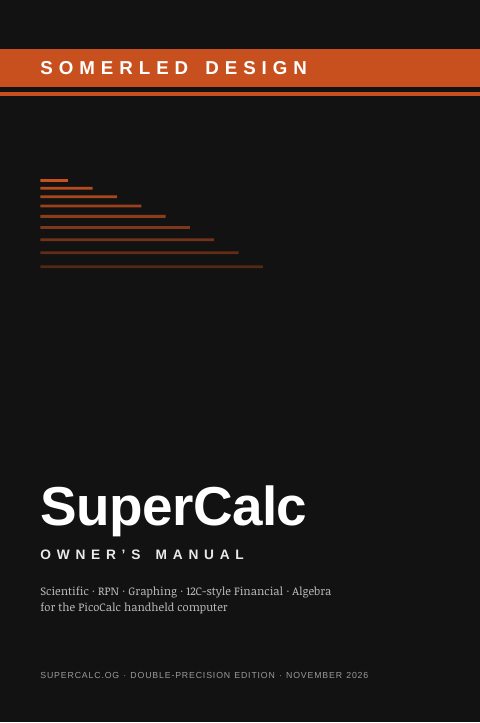

# SuperCALC

**Scientific, RPN, graphing and algebra (CAS) calculator firmware for the [ClockworkPi PicoCalc](https://github.com/clockworkpi/PicoCalc) with a Raspberry Pi Pico 2 W.**

SuperCALC is a single MicroPython firmware image for the PicoCalc. It combines a custom C math module, the [Eigenmath](https://georgeweigt.github.io/) computer algebra engine and LofiFren's PicoCalc display and keyboard drivers. Floats are IEEE 754 double precision, so calculations carry 15–16 significant digits. It also has a startup splash screen. 😁

---

## 📘 The SuperCalc Owner's Manual

<a href="docs/SuperCalc_Manual.pdf"></a>

**[Download the SuperCalc Owner's Manual (PDF, 56 pages)](docs/SuperCalc_Manual.pdf)**

The manual is a full guide in the style of the classic calculator handbooks. It has worked Press / Display examples, and every Display value in it was produced by running the SuperCalc code. It covers:

- Getting started, the screen, and display format
- Arithmetic, functions, constants, and scientific notation
- RPN entry and the stack, plus statistics on a list
- Storing and recalling values, short programs, and numeric root finding
- Full-screen graphing
- 12C mode: eight fill-in financial worksheets (TVM, savings, mortgage and amortization, loan payoff, NPV/IRR, percent/APR, date math, Black-Scholes options)
- The algebra (CAS) commands: simplify, expand, factor, derivatives, integrals, solving, and Taylor series
- Error messages, specifications and precision, troubleshooting, and a one-page command summary

The manual was written by Donna, a Grok Bot agent, for Somerled Design.

<br clear="right">

---

## Features

- **Algebraic and RPN entry.** Type `2+3*4` or `2 3 +`. The stack is visible, with `dup`, `drop`, `swap`, `over` and `lastx`.
- **Double precision.** 64-bit floats come from a MicroPython config overlay (`firmware/config/`). A single-precision build is still available.
- **C math module** (`src/math/picocalc_math.c`) for the hot paths, with a pure-Python fallback (`mp/lib/hybrid.py`).
- **Algebra (CAS)** through Eigenmath (`mp/lib/cas.py`): `simplify`, `expand`, `factor`, `d` (derivative), `int` (integral), `solve`, `taylor`, raw `eig` and `cas [clear|free]`. The engine starts on first use and can be freed to give its heap back.
- **Variables, programs and solving:** `sto` / `rcl`, user programs, and a numeric root finder (`.solve f a b`).
- **Statistics** on a list: `sum`, `mean`, `stdev` and `len`.
- **Graphing** of functions of `x`.
- **12C-style financial worksheets** (see the manual, chapters 6–10).
- **Startup splash** frozen into flash as a compact 16-colour image. You can replace it from the SD card without reflashing; see [Custom splash screen](#custom-splash-screen).
- **Fixes for working over USB:** soft-reset-safe drivers, and `mpremote` raw-paste works with the PicoCalc terminal attached.

## Installing

> **Binary releases are not available yet.** They are waiting on licensing for two upstream components; see [License](#license). Until then, build the UF2 from source as shown below.

When a release is published, installing it will take three steps:

1. Hold the **BOOTSEL** button on the Pico 2 W while you connect it to your computer over USB. It mounts as a drive named `RPI-RP2`.
2. Drag the SuperCALC `.uf2` file onto that drive. The PicoCalc reboots by itself.
3. To go back, flash the stock PicoCalc / LofiFren UF2 the same way.

The UF2 is for the **PicoCalc with a Raspberry Pi Pico 2 W (RP2350)** only.

## Building from source

`tools/build_supercalc.sh` fetches the pinned sources, applies the patches in `firmware/patches/`, and builds one UF2 into `build/`. It never flashes anything.

```sh
tools/build_supercalc.sh --check   # check tools and source refs only
tools/build_supercalc.sh           # build -> build/supercalc-og-pico2w-YYYYMMDD-double.uf2
SUPERCALC_FLOAT=single tools/build_supercalc.sh   # stock 32-bit floats
```

**You need:** `git`, `make`, `cmake`, `python3`, a host C/C++ compiler, and `arm-none-eabi-gcc` with newlib (Arm GNU Toolchain). On macOS, install them with `brew install cmake` and `brew install --cask gcc-arm-embedded`.

**Pinned sources:**

| Component | Ref |
|---|---|
| MicroPython (board `RPI_PICO2_W`) | `f187c77da8b0ff51927b62cd1f4efd78c03bdb7f` (v1.25.0-preview) |
| zenodante/eigenmath_micropython | `ea94bc5a9565f0565e04218061237096f6e0ca54` |
| LofiFren/PicoCalc (tested) | `c711a366febe21061dbfff69a616cb22e0364ccd` |

The LofiFren checkout is expected next to this project (`../LofiFren-PicoCalc/MicroPython`) or wherever `PICOCALC_DRIVER_DIR` points. The script builds from a patched copy and never edits the checkout. The comments at the top of the script cover the other options (`SUPERCALC_FW_WORK`, `JOBS`, `SUPERCALC_TAG` and the rest). The firmware image has to stay under 1.5 MB so it doesn't overlap the filesystem.

**Host tests:** run the plain-Python tests in `tests/`, for example `python3 tests/test_expr.py` or `python3 tests/test_cas.py`.

## Custom splash screen

The built-in splash comes from `firmware/frozen/sc_splash_data.py`, which `tools/make_splash.py` generates. That script needs Python 3 and Pillow.

```sh
tools/make_splash.py SPLASH.png                     # regenerate the built-in splash (rebuild the firmware afterward)
tools/make_splash.py SPLASH.png --sd splash.scs     # also write an SD card file
tools/make_splash.py SPLASH.png --preview out.png   # preview what the PicoCalc will show
```

To change the splash without reflashing, copy `splash.scs` to the root of the SD card as **`/sd/splash.scs`**. If the card or the file has any problem, SuperCALC falls back to the built-in image. Pressing any PicoCalc key dismisses the splash, and that key never reaches the menu. Otherwise it closes after a short timeout.

## Repository layout

```
src/        C user modules (math kernel, plot, VM)
mp/         MicroPython calculator layer (expression parser, CAS bridge, REPL, plot, solver)
firmware/   build config overlays, frozen modules (splash), upstream patches, diagnostics
tools/      build_supercalc.sh, make_splash.py, device sync helpers
tests/      host-side tests
docs/       Owner's Manual (PDF), architecture and bring-up notes
```

## License

SuperCALC's own code is released under the [MIT License](LICENSE), Copyright (c) 2026 Kevin R. Murphy (SomerledDesign).

The firmware build pulls in third-party components (MicroPython, the Raspberry Pi Pico SDK, eigenmath, LofiFren's PicoCalc modules and others) that keep their own licenses. See [THIRD_PARTY_NOTICES.md](THIRD_PARTY_NOTICES.md) and the full texts in [LICENSES/](LICENSES/).

- **Binary releases are on hold.** No UF2 will be published until zenodante licenses the PicoCalc display/terminal driver (`PicoCalc-micropython-driver`) and the eigenmath MicroPython wrapper (`eigenmath_micropython`), both of which are built into the firmware. UF2 files are not committed to this repository.
- **Hardware:** the SuperCALC UF2 is for the ClockworkPi PicoCalc with a Raspberry Pi Pico 2 W only. The Wi-Fi/Bluetooth components (cyw43-driver, BTstack) are licensed for use with Raspberry Pi silicon only.
- **Manual:** the Owner's Manual PDF is Copyright © 2026 Somerled Design, all rights reserved, as stated in the manual. It is not covered by the MIT License.

## Credits

SuperCALC was created by **Kevin Murphy (W8VOS, [Somerled Design](https://github.com/SomerledDesign))** in collaboration with **Claude.ai** and **Grok Bot**. That human + AI collaboration is what brought it into being.

It stands on the work of:

- **George Weigt**, author of the [Eigenmath](https://github.com/georgeweigt/eigenmath) CAS engine
- **zenodante**, author of the [PicoCalc MicroPython driver](https://github.com/zenodante/PicoCalc-micropython-driver) and the [Eigenmath MicroPython port](https://github.com/zenodante/eigenmath_micropython)
- **LofiFren**, author of the [PicoCalc MicroPython drivers, terminal and apps](https://github.com/LofiFren/PicoCalc)
- **Damien P. George and the MicroPython contributors**, for [MicroPython](https://micropython.org/)
- **Raspberry Pi Ltd**, for the Pico 2 W and the Pico SDK
- **ClockworkPi**, for the [PicoCalc](https://github.com/clockworkpi/PicoCalc) hardware

SuperCALC is not affiliated with, sponsored by, or endorsed by any calculator manufacturer. PicoCalc and Raspberry Pi are trademarks of their respective owners.
